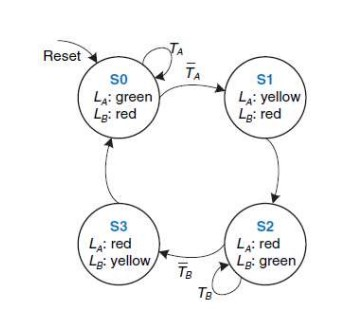
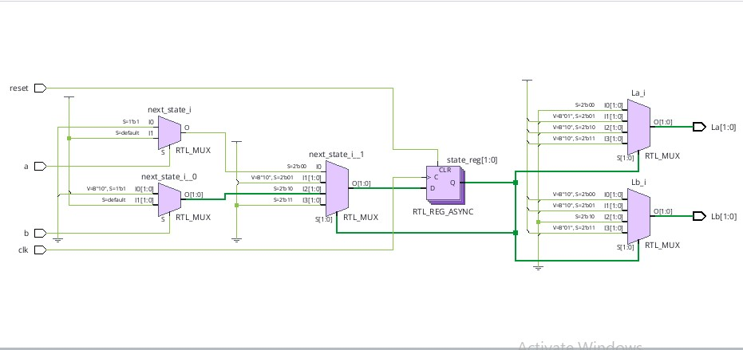
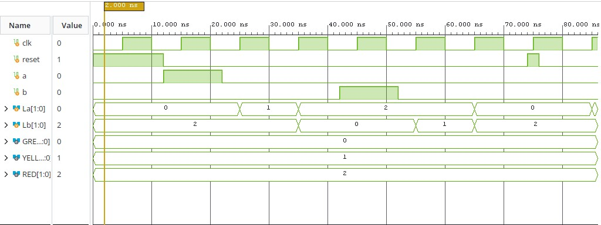

# 🚦 Traffic Light Controller Using SystemVerilog and Vivado

## 📌 Overview
A four-state Finite State Machine (FSM) based traffic light controller designed using SystemVerilog and simulated in AMD Xilinx Vivado.

## 🛠️ Tools Used
- SystemVerilog
- AMD Xilinx Vivado
- RTL Simulation

## ⚙️ Design Features
- Four-state FSM
- Clocked state transitions
- Reset functionality
- Traffic light control for two roads
- Green, yellow, and red light encodings

## 📊 State Diagram

## 🔌 RTL Design

## 🧪 Simulation Results

## 📁 Project Files
- `Traffic_Light.SV` — Main SystemVerilog design
- `Traffic_Light_tb.sv` — Testbench
- `Traffic_Light_RTL_Design.jpg` — RTL schematic
- `Traffic_Light_simulation.jpg` — Simulation waveform
- `Traffic_Light_state_diagram.jpg` — State diagram

## 🎯 Learning Outcomes
- Finite State Machine design
- Sequential logic and state transitions
- SystemVerilog coding
- Simulation and debugging using Vivado

## 👨‍💻 Author
Electronics and Communication Engineering Student
